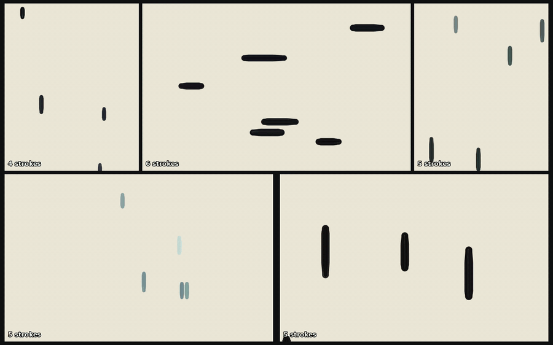

# fable-5.2-paintings

Paintings built from a blank canvas out of individual brush strokes, plus time-lapse videos of them being painted.



## Files

- `paint.py`: repaints a photo with N strokes (`python paint.py photo.jpg --strokes 8000`).
- `original.py`: original scene, lighthouse at dusk.
- `commute.py`: original scene, evening commuter train.
- `engine.py`: shared stroke renderer used by the CEO series.
- `kit.py`: the recurring CEO character (gray hair, rectangular glasses, black leather jacket).
- `ceo.py`: five "CEO stepping down" scenes: `podium`, `boardroom`, `walkout`, `mirror`, `stage`.
- `compose.py`: puts the five CEO time-lapses on one canvas, then tours each painting.

## Setup

```
python -m venv venv && venv/bin/pip install -r requirements.txt
```

Needs `ffmpeg` for videos and the DejaVu Sans Bold font for the stroke counter.

## Usage

```
python ceo.py podium --out out/podium              # still
python ceo.py podium --out out/podium --frames 330 # still + time-lapse frames
python original.py --out out/lighthouse --frames 300
python commute.py --out out/commute --frames 300
```

Each run writes `painting.png` / `painting.jpg` (and `frames/` when `--frames` is set) into the output folder. Turn frames into a video with ffmpeg:

```
ffmpeg -framerate 30 -i out/podium/frames/f%04d.png -pix_fmt yuv420p out/podium.mp4
```

`compose.py` expects the five scenes' frames in `vid3/<scene>/frames` and finished paintings in `final/<scene>/painting.png`.
